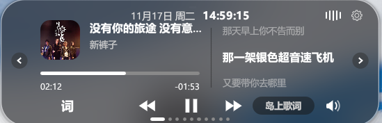
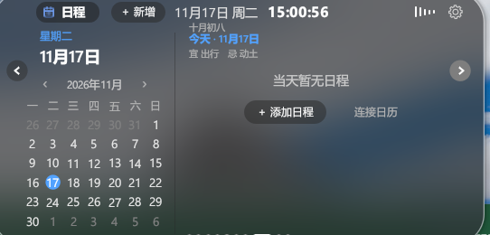
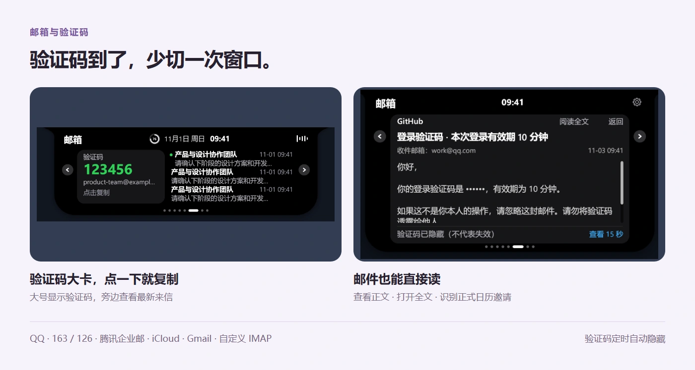
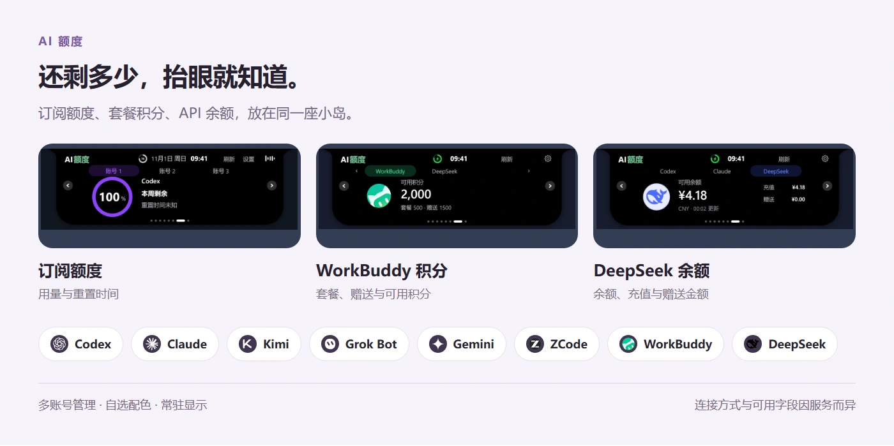

<div align="center">


# 云屿

**一座小岛，装下桌面日常。**

Windows 桌面伙伴，把消息、音乐、日程、天气和 AI 额度放到手边。

[](https://github.com/cczdnb/NimbusIsle/releases/latest)
[](#下载安装)
[](LICENSE)
[](#从源码构建与参与开发)

**[下载 Windows 版](https://github.com/cczdnb/NimbusIsle/releases/latest)** · [使用指南](docs/USAGE.md) · [更新记录](CHANGELOG.md) · [反馈问题](https://github.com/cczdnb/NimbusIsle/issues)

</div>

云屿是一款开源的 Windows 桌面小工具。平时收在屏幕边缘，鼠标靠近就展开。切歌、看日程、复制验证码、记一条待办，都能在岛上完成。收起时，岛上留着云屿的吉祥物：一张探出云朵的脸。它会眨眼、换表情，一帧一帧换整张脸；音乐响起时跟着唱歌。打开下班倒计时后，还可以按上下班时段换一套专属表情。可以在设置里关掉。

**设置 → 桌宠** 可以另外打开一只岛外的猫。它跟着键盘抬爪、跟着鼠标转头，可以贴在岛旁边，也可以拖到桌面上，拖到屏幕边时猫和键盘能贴边。默认关着，不影响岛上这张脸。需要系统已有 WebView2。

可以选刘海或胶囊，停在顶部、左侧或右侧，只留下自己要用的页面。云屿用 Rust 和 egui 写成，不依赖 Electron。


皮肤在设置里换，有经典黑、奶油、毛玻璃、悬浮云和液态玻璃。悬浮云的作者是啵（[@hanhb123](https://github.com/hanhb123)）。大小、停靠和全屏时隐藏也在 **设置 → 常规**。

## 消息先亮在岛边

微信、QQ、企业微信、飞书、钉钉有新消息时，收起的小岛会亮起图标。展开后点一下，切到对应窗口。微信多开按账号分开显示。

微信、企业微信、飞书、钉钉根据任务栏闪动提醒，不读取联系人或聊天正文。微信缩在托盘时，可以打开「托盘一键唤起微信」。QQ 走 Windows 通知，需要在 QQ 里打开系统通知，并在云屿里选择「只连接 QQ」。

通知正文默认不显示。打开预览后，识别到的验证码仍会遮住。

入口在 **设置 → 通知、邮箱与日程 → 通知**。

## 听歌时，歌词就在抬眼处



播放、暂停、切歌、音量和进度都能在岛上操作。播放器需要向 Windows 提供媒体信息。网易云音乐、QQ 音乐、酷狗、汽水音乐有额外兼容：补时长、补封面、读本机歌词缓存。网易云优先按歌曲 ID 找词。


收起后可以只留一行歌词，也可以打开「岛上歌词」，把封面、歌词和控件并排放在顶部岛体上。还可以加第二行原文、译文、频谱和可拖动的进度条。字号、对齐和每首的提前或延后，都在音乐设置里。

全局快捷键出厂是空的。在 **设置 → 音乐与歌词 → 全局快捷键** 里填写，例如 `Ctrl+Alt+P`。可以绑播放／暂停、上一首、下一首、快退 5 秒、快进 5 秒，以及唤出或隐藏云屿。某一条被系统占用时，只这一条不生效。

歌词取决于歌曲信息和歌词来源。纯音乐、电台节目或对不上的版本，可能没有同步歌词。

## 日程、待办和健康



| 想做的事 | 云屿能帮你 |
| --- | --- |
| 看今天的安排 | 月历和当日时间线。日期旁有农历、节气和常见节日，列表上方有当日宜忌。这些在本机计算，不联网 |
| 记住要做的事 | 本机待办支持单次、每天或每周重复。到下一次时恢复为待办 |
| 接上工作清单 | 第三方页可同步 Jira、Linear、GitHub Issues、Notion、飞书多维表格、Windows 待办或一份自建 JSON |
| 专心做一件事 | 专注和休息计时，收起时也能看进度 |
| 记得喝水、起来走走 | 喝水和久坐分开计时。确认或做完后再重新计。午休时段可以两边都不提醒 |

日历可接 **飞书、钉钉、企业微信、iCloud、自定义 CalDAV 和兼容的 Exchange ActiveSync**，也可以导入 `.ics`。相同日程会合并。全天、跨天和重复日程都能显示。本机新建或导入的日程留在本机；远程日历只读同步。

程序退出、关机或睡眠时，提醒不会继续弹出。

## 文件先放岛上，刚复制的字也能找回

**置物架**收拖进来的文件。可以打开、定位原文件，或再拖到别的软件。从岛上移除只是去掉记录，不删原文件。

**剪贴板**保留最近 30 条文字。点一下重新复制，常用的可以固定。历史在本机，重启还在。密码管理器标成敏感的内容不记。开关在 **设置 → 待办与置物 → 置物**。

## 验证码少切一次窗口



可以同时连多个邮箱，在岛上看信、认验证码，点一下就复制。正文可以在岛上读，也可以开独立全文窗口。网页链接交给默认浏览器。正式的日历邀请会进日程。

支持已读／未读、全部已读、移到回收站和恢复。默认只整理云屿里的记录。打开「同步邮件操作到邮箱」后，已读、删除和恢复才会写回服务器。

支持 **QQ、163、126、腾讯企业邮、iCloud、Gmail 和自定义 IMAP**。Outlook、Hotmail、Live 和 Microsoft 365 需要 OAuth，目前不支持密码直连。验证码可以在 30／60／300 秒后自动收起。

## AI 还剩多少，抬眼就知道



支持 **Codex、Claude、Kimi、Grok Bot、Gemini、ZCode、WorkBuddy、DeepSeek、豆包、Kiro、OpenCode Go、MiniMax、GLM**，以及通用余额、New API、One API、Sub2API 和自定义查询脚本。

多个账号可以分别命名、选颜色，常用的直接放在收起的小岛上。

- **Claude** 只读桌面版的本机用量记录，或接收 Claude Code 的状态栏输出。云屿不用 Claude 登录令牌，也不请求 Claude 额度接口。
- **Kiro** 只读登录缓存，显示套餐、试用和赠送／加购点数。登录过期后，请在 Kiro 里重新登录。
- **WorkBuddy** 优先认本机客户端，也可以用默认浏览器授权。
- **Gemini** 支持 Chrome 144+ 授权。先在 Chrome 登录，首次在 `chrome://inspect/#remote-debugging` 打开连接，再回到云屿点连接。会话加密留在本机。
- **豆包** 可以用浏览器登录，或从本机客户端导入当前账号，读取网页会员的 5 小时、每周和活动额度。
- **DeepSeek、OpenCode Go、MiniMax、GLM** 用 API Key。中转站可以自动识别余额接口，也可以粘贴 CC Switch 的查询脚本。脚本和凭据加密保存在本机。

某个服务连不上或登录过期时，以它自己的官方页面为准。

## 正在跑的会话，抬眼就能看见

会话页只看本机 Agent 的状态：正在跑、等你处理、报错停了、刚跑完。点一行会打开对应的软件，这一行也从岛上撤下。收起时如果有会话，岛边会显示这家软件的图标和数量，点它进入会话页。正在跑不弹提醒；等你处理、报错和刚跑完会提醒。

能读 Cursor、Claude、Codex、WorkBuddy、DeepSeek 和 Antigravity。只取状态，不把整段对话放进岛上。每一家都可以在 **设置 → 会话** 里单独关掉。刚跑完和报错停了的会话，在岛上点开，或者过了保留时间，才会消失。默认留 10 分钟，可以改成 1 到 60 分钟。在原来的软件里标成已读，不会把它从岛上拿掉。

## 出门前看一眼天气

天气页有当前实况和未来七天：温度、现象、体感、湿度、风速、日出日落，以及每天的最高／最低温和降水概率。

- 默认按当前网络出口定位。**设置 → 天气** 里也可以填城市名，回车或点「刷新天气」后生效。
- 默认来源是 **Open-Meteo**，不用密钥，大约每 15 分钟更新一次。
- 可以改用 **和风天气（自备 Key）**。填写专属 Host 和 API Key，选好城市后保存。Key 在 Windows 凭据管理器里。实况大约每 60 分钟、预报大约每 6 小时更新。本机每个自然月最多 5,000 次请求。
- 断网时继续显示上次的结果，并标出更新时间。
- 收起时，时间旁边可以显示天气图标和温度，点一下进入天气页。这一条可以在「状态组件」里单独关掉。

同一组常驻栏里，还可以打开 CPU 和内存占用，默认都是关的。电量、音量、充电、网络、大写锁定、输入语言和蓝牙连接，也会在小岛上提示。

## 下载安装

前往 **[最新正式版](https://github.com/cczdnb/NimbusIsle/releases/latest)**：

| 下载文件 | 使用方式 |
| --- | --- |
| `Yunyu-Setup-v版本号-x64.exe` | 推荐。可选安装位置、桌面快捷方式和开机自启 |
| `Yunyu-v版本号-windows-x64.zip` | 免安装。解压后运行 `yunyu.exe`，数据仍在应用数据目录 |
| `SHA256SUMS.txt` | 用 PowerShell `Get-FileHash -Algorithm SHA256` 核对 |

第一次安装默认创建桌面快捷方式，不开机自启。默认装到 `%LOCALAPPDATA%\Programs\Yunyu`。设置、待办和连接记录在 `%APPDATA%\Yunyu`，升级和卸载都保留。

更新在 **设置 → 关于 → 检查更新**。可以在应用里下载、校验后重启，也可以从发布页覆盖安装。

系统是 Windows 10／11 x64。默认用 OpenGL，初始化失败时再试 Direct3D 12。当前安装包没有商业代码签名，Windows 可能提示未知发布者。请核对仓库地址和校验值。操作细节见 [使用指南](docs/USAGE.md)。

<details>
<summary><b>连接服务之前，需要准备什么？</b></summary>

| 类型 | 支持入口 | 需要准备 |
| --- | --- | --- |
| 邮箱 | QQ、163、126、腾讯企业邮、iCloud、Gmail、自定义 IMAP | 打开 IMAP，填写授权码或 App 专用密码 |
| 日历 | 飞书、钉钉、企业微信、iCloud、CalDAV、Exchange ActiveSync | 服务商给出的同步凭据。装了桌面客户端不等于已经授权 |
| 第三方待办 | Jira、Linear、GitHub Issues、Notion、飞书、Windows 待办、自建 JSON | 对应令牌或一次微软登录。令牌进凭据管理器 |
| 下班倒计时 | 本机设置 | 设一个下班时间，倒计时精确到秒。可以按上下班时段换专属表情。不联网 |
| AI 额度 | Codex、Claude、Kimi、Grok Bot、Gemini、ZCode、WorkBuddy、DeepSeek、豆包、Kiro，以及套餐和中转站 | 本机登录、浏览器授权或 API Key，以设置里的入口为准 |

QQ 收信、邮件日程和飞书个人日历做过真实账号测试。钉钉、企业微信的日历是否能同步，取决于服务端配置，还需要你自己的账号再确认一次。

</details>

<details>
<summary><b>数据与隐私</b></summary>

- 设置、待办、本机日程、饮水、久坐、置物路径、剪贴板和连接信息在 `%APPDATA%\Yunyu`。环境变量 `YUNYU_DATA_DIR` 可以改到别的目录。
- 邮箱和日历密码、DeepSeek 等 API Key、第三方待办令牌在 Windows 凭据管理器。Gemini、豆包、WorkBuddy 的独立会话用当前 Windows 用户的 DPAPI 加密。
- 农历和宜忌、CPU、内存都在本机计算，不为此联网。
- 微信和办公软件的新消息提醒只看任务栏闪动。
- 云屿没有自己的账号服务器。打开邮件、日历、歌词、天气、额度和待办同步后，才会访问对应的服务。

完整说明见 [隐私与安全](docs/PRIVACY.md)。

</details>

<details>
<summary id="从源码构建与参与开发"><b>从源码构建与参与开发</b></summary>

需要 Rust stable、MSVC C++ 构建工具和 Windows SDK。本仓库的锁文件需要较新的 Cargo；这台开发机使用的是 `1.100.0-x86_64-pc-windows-msvc`。

```powershell
rustup run 1.100.0-x86_64-pc-windows-msvc cargo build --locked --release --bin yunyu
.\target\release\yunyu.exe
```

测试和打包：

```powershell
rustup run 1.100.0-x86_64-pc-windows-msvc cargo test --locked --all-targets --features record -- --test-threads=1
powershell -NoProfile -ExecutionPolicy Bypass -File .\scripts\package.ps1
```

测试按单线程跑，避免数据目录互相覆盖。打包需要 NSIS 3。项目结构和贡献方式见 [开发指南](CONTRIBUTING.md)。

</details>

## 开源与致谢

云屿原创代码采用 [MIT License](LICENSE)。Rust 依赖、vendored 代码、第三方图标和品牌标识沿用各自的许可。MIT 不授予这些商标的使用权，也不表示官方合作。详见 [第三方声明](THIRD_PARTY_NOTICES.txt) 和 [依赖说明](docs/DEPENDENCIES.md)。

「悬浮云」皮肤作者：啵（[@hanhb123](https://github.com/hanhb123)）。豆包网页会员额度保留了 [0011-joe 的 PR #42](https://github.com/Renly1994/xiaotang-daozai/pull/42) 里的原作者工作。感谢 egui／eframe、Rust 社区，以及提供参考与素材的开源项目。
